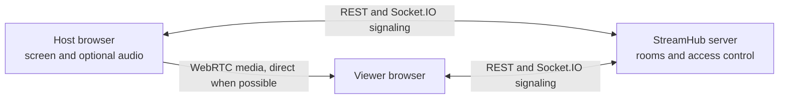

# StreamHub

Self-hosted screen sharing for a small private group. One host shares a browser tab, window, or display with up to five viewers. The web app runs on your computer or server; WebRTC carries media between browsers. The Node.js server manages rooms and exchanges connection messages. StreamHub does not record streams.

## Features

- Invite-only rooms with separate viewer and host credentials.
- Screen video and optional audio when the browser provides an audio track.
- A separate WebRTC peer connection per viewer, including late joiners.
- 720p/30, 720p/60, 1080p/30, and 1080p/60 capture targets. Actual output depends on the browser, source, network, and host hardware.
- Connection state, RTT, packet loss, jitter, resolution, frame rate, and bitrate diagnostics. RTT is **not** end-to-end video latency.
- Adaptive video bitrate when reported packet loss is high.
- An optional Discord slash-command bot for managing room invites. The bot does not stream into Discord voice channels or Go Live.

## How it works



The server checks room permissions and forwards WebRTC offers, answers, and ICE candidates. It does not relay or store video and audio. The host uploads one media stream per viewer. A STUN server helps browsers discover a direct path; restrictive networks may require a separately operated TURN relay. The optional Cloudflare Tunnel described below carries the **site and signaling**, not WebRTC media.

## Requirements

- Windows 10/11 with current Chrome or Edge for the documented host workflow. Other browsers may work but are not the tested target.
- Node.js 22 or newer and npm.
- HTTPS for screen capture from another device. Browsers also allow capture on `localhost`.

## Quick start

Clone the repository, open a terminal in its root, and create your local configuration:

```powershell
Copy-Item .env.example .env
npm.cmd ci
npm.cmd run build
npm.cmd start
```

Open <http://127.0.0.1:3001> in Chrome or Edge. On macOS or Linux, use `cp .env.example .env` and `npm` in place of `npm.cmd`. The Windows `.cmd` form also works when PowerShell execution policy blocks `npm.ps1`.

For live source changes, run `npm.cmd run dev` and open <http://127.0.0.1:5173>. Vite serves the frontend on port 5173 and proxies API and Socket.IO requests to the server on port 3001. The server binds to `127.0.0.1` by default.

## Share a room

1. Enter your name and create a room on the host browser.
2. Select **Share screen**, then choose a tab, window, or display in the browser picker. To share audio, select an available audio option. Tab audio is usually the most reliable choice in Chrome or Edge on Windows.
3. Select **Copy invite** and send the complete `/room/...#invite=...` link to viewers.
4. Viewers open the invite in Chrome or Edge, enter their names, and select **Watch stream**.
5. Use **Stop stream** to stop capture or **Close room** to revoke the invite.

The fragment after `#invite=` grants viewer access. The host credential is different and remains in that browser tab's `sessionStorage`. Do not share a host code. Anyone with a valid viewer invite can occupy an available viewer slot.

### Keep voice chat out of game audio

Before selecting **Share screen**, choose **Selected window or tab only** in **Audio to share**. Select the game window in the browser picker and enable that window's audio if offered. This mode requests window audio, excludes full-system audio, and discards audio if the browser returns a full-display capture. It prevents the usual Discord voice echo when window audio is supported. Browser audio support varies; if no audio track is available, viewers receive video without sound.

**Entire system audio** is an explicit opt-in and may include Discord voices. **No audio** sends video only. If your browser cannot capture the game's window audio, isolating game audio requires a separate audio input or virtual audio routing; the browser cannot reliably extract one app from an already mixed system-audio track. See [MDN's screen capture options](https://developer.mozilla.org/en-US/docs/Web/API/MediaDevices/getDisplayMedia).

## Access from another network

For a temporary test from your own PC, install [cloudflared](https://developers.cloudflare.com/tunnel/downloads/) and keep the StreamHub server running. In a second terminal run:

```powershell
cloudflared tunnel --url http://127.0.0.1:3001
```

Copy the temporary `https://...trycloudflare.com` URL shown by cloudflared into `.env` as `PUBLIC_ORIGIN`, with no trailing slash. Restart `npm.cmd start`, open that HTTPS URL yourself, create a new room, and send its **room invite** to the viewer. Keep the host browser tab, Node.js process, cloudflared process, and PC awake while streaming.

Quick Tunnel URLs change when the tunnel restarts. Update `PUBLIC_ORIGIN` and restart StreamHub before creating a new room. If the site loads but media never connects, configure a TURN server in `VITE_TURN_URL`, `VITE_TURN_USERNAME`, and `VITE_TURN_CREDENTIAL`, then rebuild the frontend. A TURN service relays media and consumes bandwidth. [Cloudflare Quick Tunnel](https://developers.cloudflare.com/tunnel/get-started/quick-tunnels/) is intended for temporary testing; [MDN explains STUN and TURN](https://developer.mozilla.org/en-US/docs/Web/API/WebRTC_API/Protocols).

The tunnel makes the local web server reachable through an outbound connection. You do not need to expose port 3001 on the router for the tunnel. Direct WebRTC connectivity still depends on both networks.

## Public site on Render

The repository includes `render.yaml` for a single Render web service. Create a Render Blueprint from this repository and select the free service plan shown in the file. Render builds the frontend and server, provides an HTTPS `onrender.com` URL, and runs Node.js for you. No local Node.js process or Cloudflare Tunnel is needed after deployment. The server uses Render's `PORT` and `RENDER_EXTERNAL_URL` automatically; set `PUBLIC_ORIGIN` only if you later use a custom domain. Leave Discord bot and TURN variables unset unless you configure those services separately.

Anyone can open the public site, create a room, share a screen after granting browser permission, and send the room invite. Viewers only need the invite link and a compatible browser. The host's browser and computer must remain active while sharing. The server carries room state and signaling; media remains peer to peer when a direct connection is possible.

The free Render service [spins down after 15 minutes without incoming traffic](https://render.com/docs/free/) and may take about a minute to wake. Rooms are stored only in memory, so a restart or spin-down clears them. A room with active Socket.IO traffic should stay awake, but the free plan is intended for testing and hobby use rather than guaranteed availability. Restrictive network pairs may need a TURN relay; the current configuration provides STUN only. Before inviting a wider public audience, add persistent room storage and a TURN service, then test the expected load and hosting costs.

## Configuration

Copy `.env.example` to `.env` and edit the local copy. `.env` is ignored by Git.

| Variable | Purpose |
| --- | --- |
| `HOST`, `PORT` | Server bind address and port; defaults to `127.0.0.1:3001`. |
| `PUBLIC_ORIGIN` | Exact frontend origin used for CORS and optional Discord invite links. Set to the public HTTPS origin when using a tunnel. |
| `MAX_VIEWERS` | Viewer cap, clamped to 1–5. |
| `ROOM_IDLE_MINUTES` | Cleanup time for inactive rooms. |
| `VITE_STUN_URLS` | Comma-separated STUN URLs embedded at frontend build time. |
| `VITE_TURN_URL`, `VITE_TURN_USERNAME`, `VITE_TURN_CREDENTIAL` | Optional TURN configuration embedded at frontend build time. Rebuild after changing these. |
| `DISCORD_TOKEN`, `DISCORD_CLIENT_ID`, `DISCORD_GUILD_ID` | Optional Discord bot configuration. |

## Discord bot (optional)

Set `DISCORD_TOKEN` and `DISCORD_CLIENT_ID` to register `/stream`. Set `DISCORD_GUILD_ID` during testing to register commands in one server. See the [Discord setup guide](docs/discord.md). The bot returns invites and private host codes; viewers still watch on the StreamHub website. The website works without a bot.

## Development and tests

```powershell
npm.cmd run check
npm.cmd test
npm.cmd run build
```

Automated tests cover room credentials, viewer capacity, expiration, HTTP creation, signaling permissions, late joins, and closure. They do not capture or play real media. Use the [manual test checklist](docs/manual-testing.md) for browser and cross-network checks.

```text
apps/server/src/       Express API, room store, Socket.IO signaling, optional bot
apps/server/test/      Room and signaling integration tests
apps/web/src/          React UI, capture, WebRTC playback, diagnostics
packages/shared/src/   Shared types and capture presets
scripts/               Windows launch helpers
docs/                  Setup and manual testing guides
```

## Current limits

Rooms and bot ownership are kept in memory and disappear when the server restarts. A Quick Tunnel URL disappears when cloudflared stops. There is no account system or recording. Each viewer requires a separate host upload, so five viewers can use considerable CPU and bandwidth. The quality presets and low latency are goals, not guarantees. Some network pairs will need TURN; a stable, always-on deployment also needs persistent hosting and a stable public URL.
